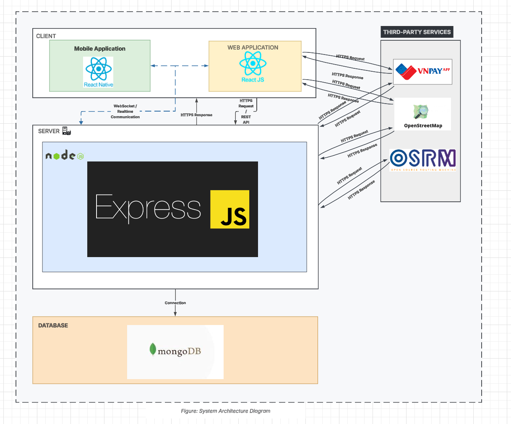

# TÀI LIỆU YÊU CẦU PHẦN MỀM (SOFTWARE REQUIREMENTS SPECIFICATION - SRS)
## DỰ ÁN: HỆ THỐNG QUẢN LÝ VẬN CHUYỂN NGỰA ĐUA XUYÊN QUỐC GIA
*(Cross-Border Racehorse Transport Management System)*

---

| Thông Tin Tài Liệu | Chi Tiết |
| :--- | :--- |
| **Mã dự án** | CBRT-2026 |
| **Phiên bản** | 1.0.0 |
| **Tác giả** | Business Analyst (BA) Team |
| **Ngày tạo** | 14/09/2026 |
| **Công nghệ áp dụng** | ExpressJS, MongoDB, ReactJS (Web), React Native (Mobile) |

---

## MỤC LỤC
1. [Giới Thiệu Dự Án & Phạm Vi](#1-giới-thiệu-dự-án--phạm-vi)
2. [Phân Tích Đối Tượng Sử Dụng (Actors & Personas)](#2-phân-tích-đối-tượng-sử-dụng-actors--personas)
3. [Yêu Cầu Chức Năng Chi Tiết (Functional Requirements - FR)](#3-yêu-cầu-chức-năng-chi-tiết-functional-requirements---fr)
4. [Yêu Cầu Phi Chức Năng (Non-Functional Requirements - NFR)](#4-yêu-cầu-phi-chức-năng-non-functional-requirements---nfr)
5. [Quy Trình Nghiệp Vụ Đặc Thù (Business Workflows & State Diagrams)](#5-quy-trình-nghiệp-vụ-đặc-thù-business-workflows--state-diagrams)
6. [Yêu Cầu Nền Tảng & Công Nghệ (Technology Stack Specifications)](#6-yêu-cầu-nền-tảng--công-nghệ-technology-stack-specifications)
   - [6.4 Kiến Trúc Hệ Thống (System Architecture)](#64-kiến-trúc-hệ-thống-system-architecture)
7. [Tiêu Chí Nghiệm Thu (Acceptance Criteria)](#7-tiêu-chí-nghiệm-thu-acceptance-criteria)

---

## 1. GIỚI THIỆU DỰ ÁN & PHẠM VI

### 1.1 Mục Đích
Tài liệu này xác định đầy đủ các yêu cầu nghiệp vụ, yêu cầu chức năng và phi chức năng nhằm xây dựng hệ thống phần mềm quản lý toàn trình quá trình vận chuyển ngựa đua xuyên quốc gia. Hệ thống phục vụ việc kết nối giữa chủ ngựa/CLB, bộ phận pháp lý kiểm dịch, điều phối viên lộ trình và tài xế/chuyên viên chăm sóc trên đường di chuyển.

### 1.2 Phạm Vi Hệ Thống (System Scope)
- **Bao gồm (In-Scope)**:
  - Quản lý lý lịch số hóa & hộ chiếu ngựa đua (FEI Passports).
  - Quản lý quy định kiểm dịch, tiêm phòng và giấy phép xuất/nhập cảnh theo quốc gia.
  - Lập kế hoạch tuyến đường đa phương thức (đường bộ xe chuyên dụng + khoang air stalls máy bay).
  - Theo dõi tiến độ hành trình theo mốc check-in điểm dừng, cập nhật thời gian thực (Realtime Trip Tracking).
  - Nhật ký sức khỏe ngựa (Horse Welfare Logging) trên thiết bị di động.
  - Xử lý sự cố khẩn cấp (SOS Emergency Response System).
  - Nghiệm thu bàn giao điện tử (Digital Proof of Delivery - POD).
- **Không bao gồm (Out-of-Scope trong v1.0)**:
  - Tích hợp cổng thanh toán quốc tế ngoài VNPAY (Thanh toán trực tuyến chỉ hỗ trợ qua cổng **VNPAY**: QR ngân hàng, thẻ ATM nội địa, thẻ Visa/Mastercard).
  - Đặt vé máy bay trực tiếp với hãng hàng không (Thực hiện qua đại lý cargo ngoài hệ thống).

---

## 2. PHÂN TÍCH ĐỐI TƯỢNG SỬ DỤNG (ACTORS & PERSONAS)

### 2.1 Ma Trận Vai Trò & Nền Tảng Sử Dụng

```
+-----------------------------------------------------------------------------------+
|                                 HỆ THỐNG CBRT                                      |
+------------------------------------------+----------------------------------------+
|           WEB PORTAL (ReactJS)           |         MOBILE APP (React Native)       |
|  - Logistics Manager                     |  - Vehicle Driver / Escort             |
|  - Transport Specialist                  |                                        |
|  - Fleet & Route Coordinator             |                                        |
|  - Customer (Portal Đặt hàng & Báo cáo)  |                                        |
+------------------------------------------+----------------------------------------+
```

### 2.2 Chi Tiết Nhiệm Vụ Các Vai Trò

#### 1. Logistics Manager (Quản lý Điều hành)
- **Nhiệm vụ**: Phê duyệt đơn đặt hàng vận chuyển; phân công tài sản & nhân sự; duyệt phương án điều chỉnh chi phí/lộ trình khẩn cấp; xem báo cáo KPI kinh doanh & chỉ số đúng giờ (OTD).
- **Điểm đau (Pain point)**: Thiếu tầm nhìn tổng quan realtime về vị trí các đoàn xe và các sự cố phát sinh trên đường quốc tế.

#### 2. Transport Specialist (Chuyên viên Thủ tục & Kiểm dịch)
- **Nhiệm vụ**: Cập nhật danh mục quy định y tế/hải quan; hướng dẫn khách hàng hoàn thiện hồ sơ; nộp và theo dõi duyệt giấy phép tiêm phòng, kiểm dịch, thông quan.
- **Điểm đau (Pain point)**: Giấy tờ bị thất lạc hoặc hết hạn giữa chừng dẫn đến ngựa bị giữ lại ở biên giới.

#### 3. Fleet & Route Coordinator (Điều phối viên Đội xe & Lộ trình)
- **Nhiệm vụ**: Quản lý xe tải chở ngựa chuyên dụng & Air Stalls; thiết lập tuyến đường tối ưu, các điểm dừng nghỉ (Rest Stops) và trạm y tế; cập nhật tiến độ lộ trình.
- **Điểm đau (Pain point)**: Khó điều chỉnh lịch trình kịp thời khi có kẹt xe hoặc thời tiết xấu tại các cửa khẩu.

#### 4. Vehicle Driver / Escort (Tài xế / Nhân viên Chăm sóc đi kèm)
- **Nhiệm vụ**: Nhận lịch trình công tác; check-in mốc di chuyển; ghi nhật ký sức khỏe & chụp ảnh ngựa định kỳ; phát báo động khẩn cấp SOS khi gặp sự cố; lấy chữ ký bàn giao (POD).
- **Điểm đau (Pain point)**: Phải thao tác khi đang di chuyển; mất sóng mạng tại các khu vực hẻm núi/biên giới.

#### 5. Customer (Khách hàng - CLB / Chủ Ngựa)
- **Nhiệm vụ**: Đăng ký yêu cầu vận chuyển; tải lên hộ chiếu & giấy khám sức khỏe ngựa; theo dõi vị trí ngựa realtime; nhận thông báo khi ngựa thông quan và bàn giao thành công.
- **Điểm đau (Pain point)**: Lo lắng về sức khỏe và sự an toàn của ngựa giá trị cao trong suốt hành trình dài.

---

## 3. YÊU CẦU CHỨC NĂNG CHI TIẾT (FUNCTIONAL REQUIREMENTS - FR)

### FR-01: Quản Lý Đơn Vận Chuyển (Booking & Order Management)
- **FR-01.1**: Hệ thống cho phép Customer tạo đơn đặt vận chuyển mới gồm: Điểm xuất phát, Điểm đến, Khung thời gian, Danh sách ngựa, Yêu cầu chăm sóc đặc biệt.
- **FR-01.2**: Hệ thống tự động sinh Mã đơn hàng duy nhất dạng `TR-YYYY-XXXX` (VD: `TR-2026-0042`).
- **FR-01.3**: Cho phép Logistics Manager xem danh sách, duyệt (`APPROVED`) hoặc từ chối (`REJECTED`) kèm lý do cụ thể.

### FR-02: Số Hóa Hồ Sơ & Kiểm Dịch Thông Quan (Compliance & Passports)
- **FR-02.1**: Cho phép quản lý hồ sơ lý lịch từng con ngựa (Tên, Mã chip 15 chữ số, Số hộ chiếu FEI, Giống, Tuổi, Cân nặng, Tiền sử bệnh).
- **FR-02.2**: Transport Specialist tạo danh mục yêu cầu tài liệu pháp lý cho chuyến đi dựa trên quốc gia đi/đến (VD: Giấy tiêm phòng Cúm ngựa, Giấy xét nghiệm Coggins, Giấy phép xuất/nhập cảnh).
- **FR-02.3**: Cho phép upload tài liệu dạng PDF/Hình ảnh, kiểm duyệt trạng thái (`PENDING_REVIEW` -> `APPROVED` / `REJECTED`).
- **FR-02.4**: Cảnh báo khi tài liệu sắp hết hạn hoặc thiếu so với quy định cửa khẩu trước ngày khởi hành 48 giờ.

### FR-03: Lập Kế Hoạch Lộ Trình & Điều Phối Phương Tiện (Fleet & Route Dispatch)
- **FR-03.1**: Quản lý danh mục phương tiện chuyên dụng (Xe tải 2/4/6 ngựa, Thùng Air Stall máy bay) cùng trạng thái hoạt động (`AVAILABLE`, `IN_USE`, `MAINTENANCE`).
- **FR-03.2**: Route Coordinator tạo Kế hoạch Lộ trình gồm chuỗi các mốc (Waypoints): Điểm đón -> Trạm dừng nghỉ (Rest Stop) -> Cửa khẩu hải quan -> Trạm giao.
- **FR-03.3**: Gán tài xế, chuyên viên chăm sóc (Driver/Escort) và phương tiện cho từng chuyến đi.
- **FR-03.4**: Tự động gửi lịch trình đến ứng dụng Mobile của Driver/Escort sau khi Manager phê duyệt.

### FR-04: Theo Dõi Hành Trình & Nhật Ký Sức Khỏe Ngựa (Welfare & Tracking)
- **FR-04.1**: Trực quan hóa vị trí xe và đường đi trên Bản đồ tương tác (Web & Mobile) với icon phân biệt trạng thái.
- **FR-04.2**: Driver/Escort thực hiện One-Tap Check-in khi xe đến/rời khỏi các mốc đường quy định.
- **FR-04.3**: Escort ghi nhật ký sức khỏe định kỳ (2-4 tiếng/lần) trên Mobile App: Thân nhiệt ngựa (°C), Lượng nước uống (lít), Tình trạng ăn, Thể trạng (`STABLE`, `STRESSED`, `UNSTABLE`), Cảnh báo (`FEVER`, `INJURED`, `DEHYDRATION`), kèm ảnh chụp thực tế từ camera phone. Nhật ký được lưu offline khi mất mạng và tự đồng bộ khi có mạng; Customer nhận ngay trên dòng thời gian sức khỏe của đơn. Thể trạng `UNSTABLE` hoặc có cảnh báo sẽ tự động tạo SOS cho điều phối.

### FR-05: Quản Lý & Xử Lý Sự Cố Khẩn Cấp (SOS Incident Resolution)
- **FR-05.1**: Nút bấm SOS tích hợp trên Mobile App cho phép Driver gửi báo động khẩn cấp ngay lập tức kèm tọa độ GPS hiện tại.
- **FR-05.2**: Web Dashboard phát chuông & hiển thị pop-up cảnh báo màu đỏ ưu tiên cao nhất khi nhận tín hiệu SOS.
- **FR-05.3**: Route Coordinator có thể chỉnh sửa lộ trình (Re-routing) để tìm xe cứu hộ hoặc phòng khám thú y gần nhất trên bản đồ.
- **FR-05.4**: Cho phép ghi nhận chi phí phát sinh khẩn cấp và gửi yêu cầu phê duyệt nhanh đến Manager.

### FR-06: Nghiệm Thu Bàn Giao Điện Tử & Báo Cáo KPI (POD & Analytics)
- **FR-06.1**: Mobile App cung cấp giao diện Ký xác nhận bàn giao (Digital Proof of Delivery - POD). Người nhận kiểm tra thể trạng ngựa và ký trực tiếp lên màn hình cảm ứng.
- **FR-06.2**: Đổi trạng thái chuyến đi thành `COMPLETED` và tự động gửi thông báo hoàn tất đến Customer.
- **FR-06.3**: Báo cáo chỉ số kinh doanh: Tỷ lệ giao hàng đúng giờ (On-time Delivery OTD %), Tổng số km di chuyển, Tổng số sự cố theo tháng, Báo cáo doanh thu & chi phí vận hành.

---

## 4. YÊU CẦU PHI CHÚC NĂNG (NON-FUNCTIONAL REQUIREMENTS - NFR)

### 4.1 Hiệu Năng (Performance Requirements)
- **NFR-01**: Thời gian phản hồi của các RESTful API chuẩn phải < **200ms** đối với 95% số lượng request.
- **NFR-02**: Độ trễ đẩy sự kiện thời gian thực (WebSocket Latency: check-in, nhật ký sức khỏe, SOS) phải < **500ms**.
- **NFR-03**: Giao diện Web Dashboard phải tải xong toàn bộ dữ liệu trang chủ trong < **2 giây**.

### 4.2 Bảo Mật (Security Requirements)
- **NFR-04**: Xác thực toàn bộ kết nối API bằng **JSON Web Token (JWT)** với cơ chế Refresh Token ngắn hạn.
- **NFR-05**: Mã hóa mật khẩu người dùng bằng thuật toán **Bcrypt** (Salt rounds >= 10).
- **NFR-06**: Mã hóa toàn bộ dữ liệu truyền tải trên mạng bằng **HTTPS/WSS (TLS 1.3)**.
- **NFR-07**: Áp dụng Phân quyền dựa trên vai trò (**RBAC**) chặt chẽ: Driver chỉ được xem chuyến đi mình được phân công; Customer chỉ được xem ngựa và đơn hàng của chính mình.

### 4.3 Tính Sẵn Sàng & Tin Cậy (Availability & Offline Capability)
- **NFR-08**: Hệ thống Backend có khả năng hoạt động liên tục với Uptime tối thiểu **99.9%**.
- **NFR-09**: **Offline-First Capability**: Mobile App của Driver phải cho phép lưu tạm các bản ghi nhật ký sức khỏe và mốc check-in vào bộ nhớ nội bộ (AsyncStorage / SQLite) khi mất kết nối 4G/5G, và tự động đồng bộ (Auto-sync) về server ngay khi có mạng trở lại.

### 4.4 Khả Năng Mở Rộng & Bảo Trì (Scalability & Maintainability)
- **NFR-10**: Cơ sở dữ liệu MongoDB được thiết kế đánh chỉ mục (Indexing) tối ưu cho các truy vấn địa lý 2D Spatial (2dsphere index trên `coordinates`).
- **NFR-11**: Mã nguồn Backend và Frontend tuân thủ chuẩn Clean Code / Modular Architecture, sẵn sàng đóng gói Docker Containers.

---

## 5. QUY TRÌNH NGHIỆP VỤ ĐẶC THÙ (BUSINESS WORKFLOWS & UML 2.0 DIAGRAMS)

> [!NOTE]
> Toàn bộ sơ đồ quy trình chi tiết thiết kế theo **chuẩn UML 2.0** (gồm *Use Case Diagram*, *State Machine Diagram*, *Activity Diagrams với Swimlanes*, và *Sequence Diagrams*) đã được tổng hợp chi tiết tại tệp: **[UML_2.0_FLOW_DIAGRAMS.md](file:///d:/WDP301/UML_2.0_FLOW_DIAGRAMS.md)**.

### 5.1 Sơ Đồ Trạng Thái Đơn Vận Chuyển (Transport Request Lifecycle)

```
[CUSTOMER] Tạo Đơn 
      │
      ▼
(PENDING_APPROVAL) ──(Từ chối)──► (REJECTED)
      │
  (Duyệt)
      ▼
(APPROVED) ──(Tải lên hồ sơ)──► (DOCS_PROCESSING)
                                      │
                              (Thông quan OK)
                                      ▼
(IN_TRANSIT) ◄──(Khởi hành)─── (CLEARED_FOR_TRANSPORT)
      │
      ├────(Gặp sự cố SOS)──► (INCIDENT_HANDLING) ──(Khắc phục)──┐
      │                                                          │
      ▼                                                          │
(DELIVERING) ◄───────────────────────────────────────────────────┘
      │
  (Ký POD)
      ▼
 (COMPLETED)
```

---

## 6. YÊU CẦU NỀN TẢNG & CÔNG NGHỆ (TECHNOLOGY STACK SPECIFICATIONS)

### 6.1 Backend Stack (Server Platform)
- **Language & Runtime**: Node.js (v18+)
- **Framework**: Express.js 4 (REST API architecture, prefix `/api/v1`)
- **Real-time Communication**: Socket.io 4 (thông báo, cập nhật trạng thái chuyến/điểm dừng & cảnh báo SOS)
- **Database ORM/ODM**: Mongoose 8 (MongoDB)
- **Authentication & Security**: JSON Web Token (jsonwebtoken), mã hóa mật khẩu bằng bcryptjs
- **API Documentation**: Swagger (swagger-jsdoc + swagger-ui-express) tại `/api-docs`
- **File Storage**: Lưu trực tiếp trong MongoDB (hồ sơ/giấy tờ ngựa dạng Buffer; chữ ký POD dạng ảnh PNG base64)
- **Tích hợp bên ngoài**: VNPAY (thanh toán), OpenStreetMap Nominatim (geocoding), OSRM (tính tuyến đường)

### 6.2 Frontend Web Stack (Admin & Coordination Portal)
- **Library & Build Tool**: ReactJS 18 + Vite 5
- **UI Framework**: Ant Design + Lucide React (icon)
- **Routing**: React Router
- **State Management**: Zustand
- **HTTP Client**: Axios
- **Real-time Client**: socket.io-client
- **Map Library**: Leaflet + React-Leaflet (tile bản đồ OpenStreetMap)

### 6.3 Mobile App Stack (Driver & Escort Mobile Platform)
- **Đối tượng sử dụng**: Driver (điều hành hành trình, POD) và Escort (nhật ký sức khỏe ngựa); Customer sử dụng Web Application
- **Framework**: React Native 0.86 với Expo SDK 57 (TypeScript)
- **Navigation**: Expo Router (file-based routing)
- **Lưu trữ phiên đăng nhập**: Expo Secure Store (lưu JWT an toàn trên thiết bị)
- **Offline Queue**: Expo SQLite (lưu tạm check-in, nhật ký sức khỏe kèm ảnh, SOS khi mất mạng; tự đồng bộ khi có mạng trở lại)
- **Camera & Ảnh**: Expo Image Picker (chụp ảnh thể trạng ngựa) + Expo Image Manipulator (thu nhỏ ≤1280px, nén JPEG trước khi gửi)
- **Real-time Client**: socket.io-client (nhận thông báo)
- **Signature Engine**: Tự xây dựng — ghi nét vẽ cảm ứng và chuyển thành ảnh PNG để nghiệm thu POD

### 6.4 Kiến Trúc Hệ Thống (System Architecture)



*Hình: Sơ đồ kiến trúc hệ thống (System Architecture Diagram)*

Hệ thống được xây dựng theo mô hình **Client – Server** gồm 4 thành phần chính:

| Thành phần | Công nghệ | Vai trò |
| :--- | :--- | :--- |
| **Client – Web Application** | ReactJS + Vite | Cổng quản trị & điều phối cho Manager, Specialist, Coordinator; cổng đặt đơn & thanh toán cho Customer. |
| **Client – Mobile Application** | React Native (Expo) | Ứng dụng cho Driver/Escort: check-in điểm dừng, nhật ký sức khỏe, POD, SOS. Có hàng đợi offline (SQLite) tự đồng bộ khi có mạng. |
| **Server** | Node.js + Express.js | Cung cấp RESTful API, xác thực JWT, phân quyền RBAC, xử lý nghiệp vụ, đẩy sự kiện realtime qua Socket.io. |
| **Database** | MongoDB (Mongoose ODM) | Lưu trữ toàn bộ dữ liệu nghiệp vụ: người dùng, ngựa, đơn hàng, chuyến đi, giao dịch thanh toán, sự cố. |

**Các luồng giao tiếp chính:**

1. **Client ↔ Server (HTTPS / REST API)**: Web và Mobile gửi request tới `/api/v1` kèm JWT; Server trả về dữ liệu JSON.
2. **Client ↔ Server (WebSocket / Realtime)**: Web và Mobile duy trì kết nối Socket.io (xác thực JWT) để nhận thông báo mới, cập nhật trạng thái chuyến/điểm dừng và cảnh báo SOS theo thời gian thực.
3. **Server ↔ Database**: Server kết nối MongoDB qua Mongoose để đọc/ghi dữ liệu.

**Tích hợp dịch vụ bên thứ ba:**

| Dịch vụ | Kết nối với | Mục đích |
| :--- | :--- | :--- |
| **VNPAY** | Web Application, Server | Server tạo URL thanh toán có chữ ký; Web chuyển hướng Customer sang cổng VNPAY để đặt cọc/thanh toán; VNPAY gọi **IPN callback** về Server để xác nhận kết quả giao dịch. |
| **OpenStreetMap** | Web Application, Server | Web tải tile bản đồ (Leaflet) để hiển thị vị trí & lộ trình; Server dùng **Nominatim** để tìm kiếm và chuyển đổi địa chỉ thành tọa độ (geocoding). |
| **OSRM** | Server | Tính toán tuyến đường, quãng đường và thời gian di chuyển phục vụ lập kế hoạch chuyến. |

---

## 7. TIÊU CHÍ NGHIỆM THU (ACCEPTANCE CRITERIA)

| Mã AC | Chức năng kiểm thử | Tiêu chí nghiệm thu thành công |
| :--- | :--- | :--- |
| **AC-01** | Tạo & Duyệt Đơn | Customer tạo thành công đơn vận chuyển; Manager nhận thông báo và duyệt đơn < 3 click. Mã đơn `TR-XXXX` được khởi tạo tự động. |
| **AC-02** | Số hóa Hộ chiếu Ngựa | Transport Specialist xem được bản số hóa hộ chiếu FEI, tiêm phòng; đánh dấu trạng thái duyệt hồ sơ thành công. |
| **AC-03** | Check-in Hành trình Realtime | Driver bấm check-in điểm dừng trên Mobile App; tiến độ hành trình trên Web của Customer cập nhật tương ứng mà không cần F5 lại trang. |
| **AC-04** | Nhập Nhật ký Sức khỏe | Escort chụp ảnh vết thương/thể trạng ngựa trên Mobile App; Ảnh và thông số nhiệt độ hiển thị tức thì trên dòng thời gian của Customer. |
| **AC-05** | Báo động SOS Khẩn cấp | Bấm nút SOS 3s trên Mobile; Web Dashboard đổi màu đỏ, phát chuông báo động và hiển thị chính xác vị trí sự cố trên bản đồ. |
| **AC-06** | Ký Bàn giao POD | Customer ký tên trực tiếp trên màn hình điện thoại; Chuyến đi đổi trạng thái `COMPLETED` và xuất file biên bản PDF thành công. |

---
*Tài liệu Yêu cầu Phần mềm (SRS) này là căn cứ chính thức để đội ngũ Kỹ sư Lập trình (Developers) và Kiểm thử (QA/QC) triển khai xây dựng hệ thống.*
